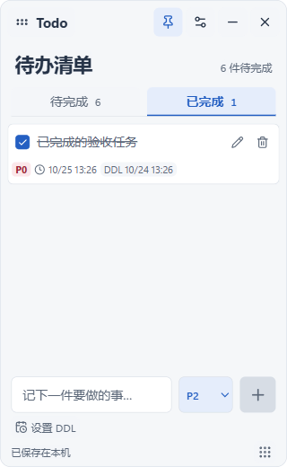
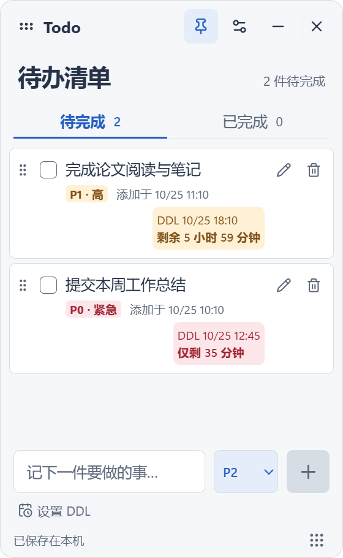
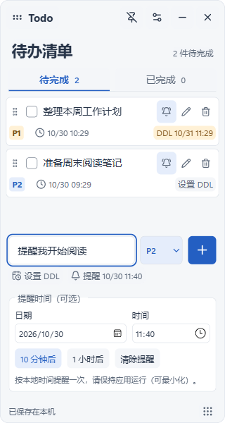
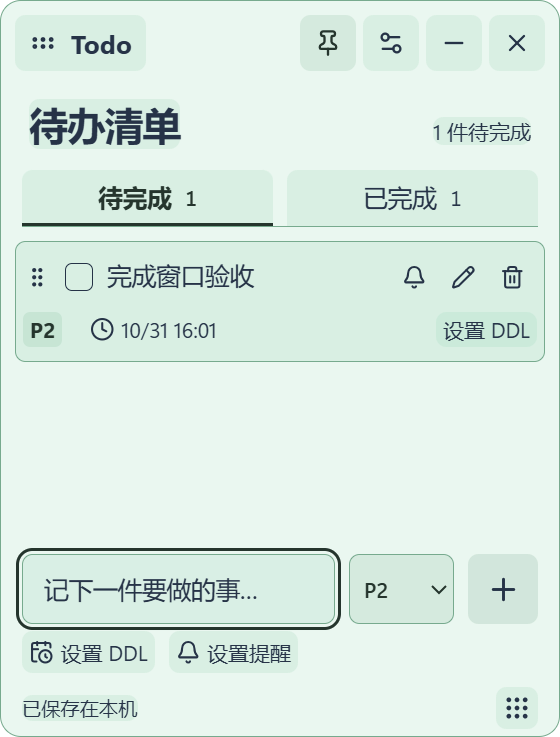
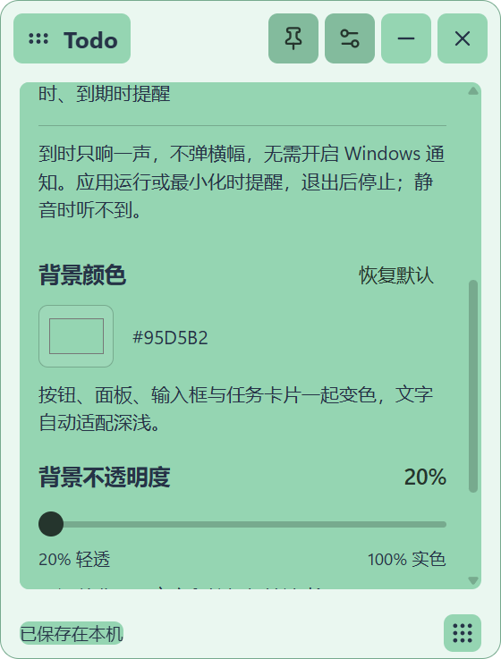

# Todo Widget

放在 Windows 11 桌面上的轻量待办便笺。随手记录、勾选完成，关闭后再打开，清单和窗口设置都会恢复。基于 Tauri 2、Vue 3 和 TypeScript，数据保存在本机，无需账号。

**[下载最新版](https://github.com/0xSilasLim/todo-widget/releases/latest)** · [使用方法](#使用方法) · [开发与构建](#开发与构建) · [验收记录](ACCEPTANCE.md)








## 下载与安装

支持 **Windows 11 x64，Build 22000 及以上**，需要 [Microsoft Edge WebView2 Evergreen Runtime](https://developer.microsoft.com/microsoft-edge/webview2/)。Windows 11 通常已包含该运行时；启动提示缺少 WebView2 时，请从 Microsoft 官网安装 Evergreen Runtime。

| 文件 | 用途 |
| --- | --- |
| [Todo-Widget-x64-setup.exe](https://github.com/0xSilasLim/todo-widget/releases/latest/download/Todo-Widget-x64-setup.exe) | 推荐。安装到当前 Windows 用户，之后从开始菜单启动。 |
| [todo-widget.exe](https://github.com/0xSilasLim/todo-widget/releases/latest/download/todo-widget.exe) | 免安装版。放到固定目录，直接双击运行。 |
| [SHA256SUMS.txt](https://github.com/0xSilasLim/todo-widget/releases/latest/download/SHA256SUMS.txt) | 两个发布文件的 SHA-256 校验值。 |

1. 下载上面的安装包，或前往 [Releases](https://github.com/0xSilasLim/todo-widget/releases) 选择版本。
2. 双击安装包完成安装，再从开始菜单打开 **Todo Widget**。
3. 首次启动时，窗口默认出现在主屏工作区右上角，尺寸为 320 × 420 逻辑像素，顶部和右侧各留 16 逻辑像素。

更新时先退出正在运行的 Widget，再运行新安装包。免安装版替换原 EXE 即可。两种版本共用当前用户的本地数据目录，更新前也可以按下文说明备份数据。

发布文件目前未进行代码签名，Windows 可能显示发布者未知。请从本仓库的 Release 页面获取文件。

## 功能

- 新增、编辑、完成和删除待办，支持拖动排序及键盘排序。
- “待完成 / 已完成”分别显示任务数量，勾选后自动归入已完成；可恢复任务或确认后永久删除。
- 每条新任务显示添加时间，编辑、完成和重启均保留；旧任务没有时间记录时显示“添加时间未知”。
- 可选 DDL 截止时间、实时剩余时间和逾期标记；到时播放简短提示音。
- 每条待办可设置 P0–P3 优先级，新增、编辑时均可选择，重启后保留。
- 无边框透明窗口，可自选整套界面颜色：按钮、输入框、设置面板、页签、任务卡片与开关一起变色，文字自动适配深浅。20%–100% 背景不透明度同时作用于窗口、卡片、面板及控件底色，文字与图标保持不透明。
- 拖动位置、调整大小、锁定位置，以及随时切换始终置顶。
- 保存任务、排序、背景颜色与不透明度、置顶、锁定、窗口位置与大小，重启后恢复。
- 单实例运行：再次双击只唤起已有窗口；窗口最小化时会恢复并获得焦点。
- 使用系统任务栏及常规最小化、Alt+Tab、Alt+F4 交互。

## 使用方法

| 操作 | 方法 |
| --- | --- |
| 新增 | 在底部输入框输入任务，选择优先级，按 Enter 或点击加号。默认 P2。 |
| 完成 | 勾选任务后，自动从“待完成”移入“已完成”；当前页保持不变。 |
| 查看 / 恢复已完成任务 | 点击“已完成”页签；取消任务勾选可恢复到“待完成”，保留文字、优先级和原添加时间。 |
| 永久删除已完成任务 | 在“已完成”中点击垃圾桶，再点击“永久删除”。取消或按 Esc 会保留任务。 |
| 查看任务信息 | 正文下方同一行显示优先级 P0–P3、时钟图标与添加时间、DDL；信息栏贴近正文，使用 12px 字号和至少 16px 字段间距，DDL 靠最右侧对齐。日期均按 Windows 本地时间显示到分钟，悬停查看完整说明和截止倒计时。 |
| 设置 DDL | 新增区点击日历按钮，或点击任务上的“设置 DDL”；选择本地日期和时间。只选日期默认 23:59。 |
| 修改 / 清除 DDL | 点击卡片上的 DDL 或铅笔，保存修改；“清除 DDL”后保存即可取消截止时间。 |
| 设置提醒时间 | 新增区点击“设置提醒”，或点击任务上的铃铛；选择日期与时分，保存后在指定时间提醒一次。无需设置 DDL。 |
| 修改 / 清除提醒 | 点击铃铛进入编辑；修改日期和时间，或点击“清除提醒”，然后保存。响铃图标表示已设置，悬停查看完整时间。 |
| 开启 DDL 自动提醒 | 在设置中开启“DDL 自动提醒”（默认关闭）。未单独设置提醒的任务，在 DDL 前 1 小时和到期时各提醒一次。 |
| 编辑 | 点击铅笔，可修改内容和优先级；Enter 保存，Shift+Enter 换行，Esc 取消。支持中文输入法确认。 |
| 删除待办 | 在“待完成”中点击任务旁的垃圾桶。 |
| 排序 | 拖动待完成任务左侧的排序柄；排序柄获得焦点后，也可按 Alt+↑ / Alt+↓。已完成任务不参与排序。 |
| 移动窗口 | 按住顶部的 Todo 区域拖动。 |
| 调整大小 | 拖动窗口边缘或右下角；最小尺寸为 280 × 320 逻辑像素。 |
| 始终置顶 | 点击顶部图钉，或在设置中切换。 |
| 背景颜色 | 在窗口设置中找到“背景颜色”，点击色块打开色盘，自选颜色并确认保存。按钮、输入框、面板、页签、任务卡片、开关及滑块一起变色，文字及图标自动适配深浅。选择时即时预览，重启后恢复；“恢复默认”只还原默认配色，保留透明度。 |
| 锁定 / 背景不透明度 | 点击顶部设置按钮。透明度滑块同时调整窗口、任务卡片、按钮、输入框和设置面板的底色，文字与图标不变淡。锁定后仍可编辑任务，但不能移动或缩放窗口。 |
| 恢复默认位置 | 在设置中点击“回到主屏右上角”，保留当前窗口大小。 |
| 最小化 / 退出 | 点击减号最小化；叉号或 Alt+F4 保存后退出。再次运行会恢复清单。 |

后续启动会恢复保存的位置和大小。移除原显示器后，窗口会回到主屏可用区域。位置计算考虑显示器缩放与任务栏占位。

启动默认打开“待完成”。任务完成后不会自动删除，旧版已经勾选的任务也会出现在“已完成”中。任务恢复后回到原有手动顺序中的相应位置。查看已完成任务时新增待办，会自动切回“待完成”，显示刚添加的任务。

添加时间仅在首次创建任务时记录。旧版未保存过这个信息，因此升级后不会用升级时间补写历史添加时间。

### DDL 与提醒

每条任务可独立设置一个提醒时间。新增时点击底部“设置提醒”，已有任务点击行内铃铛，选择本地日期和时分；支持“10 分钟后”“1 小时后”快捷设置，也可清除。新设置的时间必须晚于当前时间，新增成功后提醒字段会清空。

指定提醒不要求设置 DDL，也不需要打开 DDL 自动提醒开关。设置后仅按指定时间提醒一次；未设置指定时间的任务，继续沿用原 DDL 自动提醒开关。提醒时间和发送记录随清单持久化，编辑文字、排序或重启不会重置已发送记录。完成、删除或清除提醒会停止后续触发；恢复任务时，尚未发送但已经到时的提醒补发一次。修改提醒时间会重新安排。

指定时间提醒和 DDL 自动提醒均由应用直接播放内置的 0.6 秒短提示音，不循环、不弹横幅，也不写入通知中心。无需开启 Windows 通知或为免安装版注册通知来源，开启系统“请勿打扰”时仍可响铃。提示音作为普通应用音频播放，仍受系统 / 应用音量、静音和输出设备影响；听不到时请检查 Windows 音量混合器中的 Todo Widget 与输出设备。

DDL 为可选项，保存的是明确的时间点，按 Windows 本地时区输入和显示。卡片上的优先级、添加时间、“DDL 月/日 时:分”保持在同一行，悬停 DDL 查看含年份的完整截止时间和剩余时间：超过 24 小时为中性色、24 小时内为琥珀色、1 小时内为红色，到期后前缀显示“逾期”。完成后保留截止时间但停止紧迫提示，恢复任务后按当前时间重新计算。DDL 不改变 P0–P3 优先级或手动顺序。

提醒由 Rust 线程每 15 秒按系统时间检查，不依赖最小化 WebView 的定时器。没有指定提醒时间且开启 DDL 自动提醒时，在剩余 1 小时以内和到期时各播放一次提示音；同一任务 / DDL 的提醒阶段保存在 Store，重启不重复。错过阶段时只补当前相关的一次提醒。修改 DDL 会重新安排，完成、删除或清除 DDL 后停止后续 DDL 提醒。新增成功后，输入区清除 DDL，避免下一项继承。

应用必须保持运行，最小化后仍提醒；点击叉号或 Alt+F4 完全退出后不会后台提醒。安装版与免安装版的声音提醒行为相同。提醒记录表示音频播放请求已成功启动，不代表扬声器一定可闻；静音、音量和设备状态仍需检查。当前版本不提供后台服务、托盘常驻或退出后的系统定时任务。

### 任务优先级

| 等级 | 含义 |
| --- | --- |
| P0 | 紧急，最高优先级 |
| P1 | 高优先级 |
| P2 | 普通，默认值 |
| P3 | 低优先级 |

任务文字下方会显示优先级标签。新增任务后，输入区的优先级恢复为 P2；编辑时也可以只调整优先级，取消编辑则保留原值。修改优先级不会自动重排清单，拖动和键盘排序继续可用。

旧版任务升级后自动显示为 P2，原有文字、完成状态与顺序保留，无需手动迁移数据。

## 数据与备份

任务和设置通过 Tauri Store 保存在：

```text
%APPDATA%\com.local.todowidget\widget.json
```

退出应用后，复制这个文件即可备份。恢复时先退出应用，再将备份放回相同位置。免安装版的数据同样存放在这里，不保存在 EXE 旁边。

保存失败时，界面会显示重试入口并阻止退出，保留当前尚未保存的操作。当前版本没有账号系统、云同步、后端 API、系统托盘或开机自启。

## 开发与构建

开发环境需要 Windows 11、Node.js 24 LTS、Rust stable MSVC，以及 Visual Studio 2022 的 C++ 构建工具和 Windows SDK。详细环境说明见 [Tauri Windows 开发前置条件](https://v2.tauri.app/start/prerequisites/#windows)。

```powershell
git clone https://github.com/0xSilasLim/todo-widget.git
cd todo-widget
npm ci
npm run desktop:dev
```

项目脚本优先使用 `.tooling/` 中的本地 Rust 工具链；没有本地工具链时使用系统安装的 Rust。`.tooling/` 不包含在源码仓库中。

生成发布版与安装包：

```powershell
npm run desktop:build -- --ci -- --locked
npm run release:prepare
```

Tauri 原始产物位于 `src-tauri/target/release/`；`release:prepare` 会检查前后端版本一致性，并将安装包、免安装 EXE 和 `SHA256SUMS.txt` 整理到 `release/`。

`npm run dev` 仅用于浏览器预览界面。任务读取和保存需要原生 Tauri 环境；浏览器预览不会另建 localStorage 数据源。

### 检查与测试

```powershell
npm run build
npm test
npm run test:rust -- --locked
npm run check:rust
```

原生自动验收连接真实 Tauri WebView2，另外需要 Python 3 与 Pillow。它使用隔离的数据目录和应用标识，不修改个人清单。两项原生测试需要顺序运行，CDP 端口分别为 9223 和 9243：

```powershell
npm run tauri -- build --debug --no-bundle -- --locked
npm run test:native
npm run test:single-instance
```

只验收整套界面配色时，可在完成 Debug 构建后运行 `npm run test:native:theme`；它覆盖模块颜色、实色悬停对比度、20% / 55% / 100% 模块底色 Alpha 与文字不透明像素、重启持久化及窗口设置，跳过较长的声音提醒等待，不替代完整任务与提醒验收。

报告、截图与测试数据生成在本地 `artifacts/` 中，不提交到 Git。测试数据目录覆盖和调试端口只用于测试；发布版不包含测试目录覆盖入口。

### 发布新版本

[Windows Release 工作流](.github/workflows/release.yml) 会在推送 `v*` 标签后，执行前端测试、Rust 测试、Clippy 和 Windows x64 构建，然后创建 GitHub Release 并上传三个发布文件。

1. 更新 `package.json` / `package-lock.json`、`src-tauri/Cargo.toml` / `Cargo.lock` 和 `src-tauri/tauri.conf.json` 中的版本。
2. 更新 [RELEASE_NOTES.md](RELEASE_NOTES.md)，提交改动。
3. 推送分支和相应版本标签。例如下一版本为 `0.4.1` 时：

```powershell
git push origin main
git tag v0.4.1
git push origin v0.4.1
```

标签必须与应用版本一致。工作流使用 GitHub 自带的 `GITHUB_TOKEN` 发布，无需配置额外的发布 Token。构建失败时不会创建 Release。

## 项目结构

```text
src/
  components/       顶栏、任务列表、任务行、输入框和设置面板
  composables/      任务状态、排序、保存队列与错误恢复
  services/         原生数据与窗口调用
src-tauri/
  src/geometry.rs   DPI、多屏和工作区几何计算
  src/window.rs     窗口定位、恢复与几何保存
  src/persistence.rs  Tauri Store 与数据校验
  src/lib.rs        单实例启动及应用命令
  capabilities/     Tauri v2 最小权限配置
tests/              Vue 组件与状态测试
scripts/            开发、原生验收与发布文件整理
.github/workflows/  Windows 自动构建和 Release 发布
```

前端只获得应用专用数据与窗口命令、必要的最小化 / 退出及事件权限；Store 从 Rust 访问固定文件，前端不能指定任意文件路径。窗口背景使用 CSS `rgba`，没有对整个容器施加 `opacity`。

## 已验证范围

已在 Windows 11 25H2、175% 缩放的真实设备上验证任务分类、恢复、永久删除确认、添加时间持久化、透明背景、右上角定位、置顶、拖动 / 缩放 / 锁定、常规 Windows 交互和单实例唤回。组件与状态测试、Rust 几何与数据测试通过，详细记录见 [ACCEPTANCE.md](ACCEPTANCE.md)。

本机只有一台真实显示器；混合 DPI 多屏、屏幕热拔插及其他任务栏方向由几何单元测试覆盖，尚未在对应硬件上复核。安装包已成功构建，安装 / 卸载流程尚未单独验收。

遇到问题可在 [Issues](https://github.com/0xSilasLim/todo-widget/issues) 中说明应用版本、Windows 版本、缩放比例与复现步骤。
